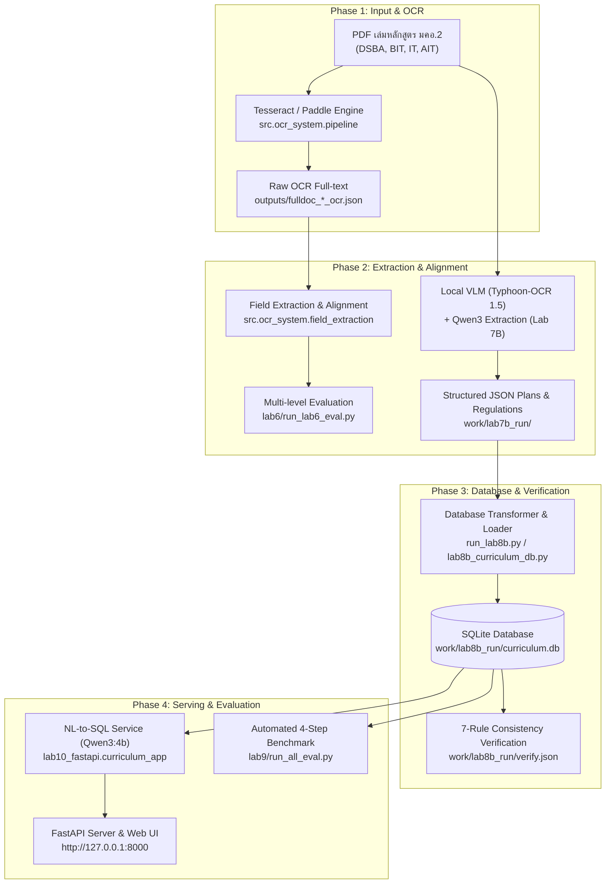
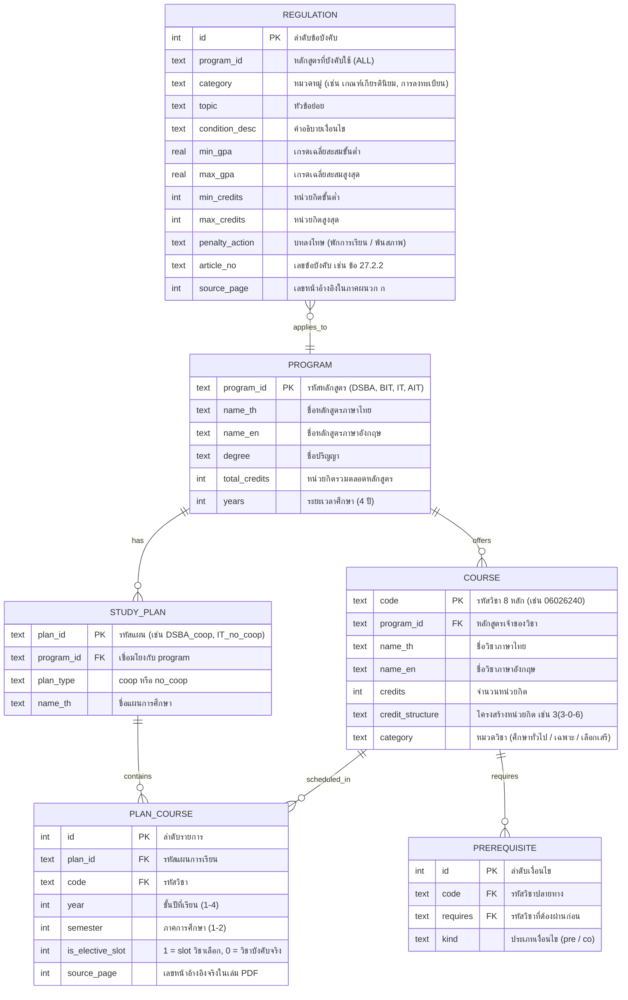

# คู่มือการดำเนินงานระบบหลักสูตรอัจฉริยะ (ISD 2026: Luksuitpiti)
## End-to-End CLI Pipeline Guide, Database Architecture & Step-by-Step Spoken Scripts

เอกสารนี้รวบรวมขั้นตอนคำสั่ง Command-Line Interface (CLI) ตั้งแต่เปิดเครื่องคอมพิวเตอร์ ทำการถอดรหัสเอกสาร PDF ด้วย OCR, การสกัดโครงสร้างรายวิชาและข้อบังคับสถาบันฯ ครบทั้ง 4 หลักสูตร (**DSBA / BIT / IT / AIT**), การนำเข้าและตรวจสอบความสอดคล้องของฐานข้อมูล SQLite, ไปจนถึงการเปิดระบบบริการถาม-ตอบผ่าน Web Application **โดยมี "สคริปต์บทพูดพรีเซนต์กำกับอธิบายในทุกๆ ขั้นตอน (Phase 0 – Phase 6)" อย่างละเอียด**

---

## สารบัญ
1. [ภาพรวมสถาปัตยกรรมระบบ (System Architecture)](#1-ภาพรวมสถาปัตยกรรมระบบ-system-architecture)
2. [ข้อมูลและเลขหน้าของทั้ง 4 หลักสูตร](#2-ข้อมูลและเลขหน้าของทั้ง-4-หลักสูตร)
3. [ขั้นตอนการทำงาน CLI ตั้งแต่เปิดเครื่องคอมพิวเตอร์ พร้อมสคริปต์บทพูด](#3-ขั้นตอนการทำงาน-cli-ตั้งแต่เปิดเครื่องคอมพิวเตอร์-พร้อมสคริปต์บทพูด)
   - [Phase 0: การเตรียมความพร้อมสภาพแวดล้อม (Environment & Local Models)](#phase-0-การเตรียมความพร้อมสภาพแวดล้อม-environment--local-models)
   - [Phase 1: การประมวลผล OCR จากเอกสาร PDF ทั้งเล่ม (Lab 1 – 3)](#phase-1-การประมวลผล-ocr-จากเอกสาร-pdf-ทั้งเล่ม-lab-1--3)
   - [Phase 2: การสกัดข้อมูลระดับฟิลด์และประเมินผลเบื้องต้น (Lab 4 – 6)](#phase-2-การสกัดข้อมูลระดับฟิลด์และประเมินผลเบื้องต้น-lab-4--6)
   - [Phase 3: การสกัดแผนการศึกษาและข้อบังคับด้วย Local AI (Lab 7B)](#phase-3-การสกัดแผนการศึกษาและข้อบังคับด้วย-local-ai-lab-7b)
   - [Phase 4: การนำเข้าข้อมูลสู่ฐานข้อมูล SQLite & ตรวจสอบ 7 กฎ (Lab 8B)](#phase-4-การนำเข้าข้อมูลสู่ฐานข้อมูล-sqlite--ตรวจสอบ-7-กฎ-lab-8b)
   - [Phase 5: การทดสอบ Benchmark ทั้งระบบ 4 ขั้นตอน (Lab 9)](#phase-5-การทดสอบ-benchmark-ทั้งระบบ-4-ขั้นตอน-lab-9)
   - [Phase 6: การเปิดใช้งาน Web Application และ API Service (Lab 10)](#phase-6-การเปิดใช้งาน-web-application-และ-api-service-lab-10)
4. [โครงสร้างตารางฐานข้อมูลและการเชื่อมโยง (Database Schema)](#4-โครงสร้างตารางฐานข้อมูลและการเชื่อมโยง-database-schema)

---

## 1. ภาพรวมสถาปัตยกรรมระบบ (System Architecture)



---

## 2. ข้อมูลและเลขหน้าของทั้ง 4 หลักสูตร

| หลักสูตร | ชื่อปริญญาและสาขาวิชา | หน่วยกิตรวม | แผนการศึกษา | ช่วงหน้า PDF ของตารางแผน | ช่วงหน้าโครงสร้างเต็ม |
|---|---|:---:|---|:---:|:---:|
| **DSBA** | วท.บ. (วิทยาการข้อมูลและการวิเคราะห์เชิงธุรกิจ) | 132 | แผนปกติ (`no_coop`)<br>แผนสหกิจ (`coop`) | หน้า 26–32<br>หน้า 33–39 | หน้า 22–32<br>หน้า 22–25, 33–39 |
| **BIT** | วท.บ. (เทคโนโลยีสารสนเทศทางธุรกิจ) | 126 | แผนปกติ (`no_coop`)<br>แผนสหกิจ (`coop`) | หน้า 26–30<br>หน้า 31–35 | หน้า 22–30<br>หน้า 22–25, 31–35 |
| **IT** | วท.บ. (เทคโนโลยีสารสนเทศ) | 130 | แผนปกติ (`no_coop`)<br>แผนสหกิจ (`coop`) | หน้า 32–38<br>หน้า 39–45 | หน้า 24–38<br>หน้า 24–31, 39–45 |
| **AIT** | วท.บ. (เทคโนโลยีปัญญาประดิษฐ์) | 120 | แผนเดี่ยว (`single`) | หน้า 23–26 | หน้า 21–26 |
| **ข้อบังคับสถาบันฯ** | ข้อบังคับ สจล. ว่าด้วยการศึกษาระดับปริญญาตรี 2564 | - | ภาคผนวก ก | หน้า 89, 91, 92, 93, 94, 96 | - |

---

## 3. ขั้นตอนการทำงาน CLI ตั้งแต่เปิดเครื่องคอมพิวเตอร์ พร้อมสคริปต์บทพูด

---

### Phase 0: การเตรียมความพร้อมสภาพแวดล้อม (Environment & Local Models)

เมื่อเปิดเครื่องคอมพิวเตอร์ ให้เปิด PowerShell และเข้าไปยังโฟลเดอร์โปรเจกต์:

```powershell
# 1. เข้าสู่ไดเรกทอรีโปรเจกต์
cd C:\Users\thewh\Downloads\isd-2026-luksuitpiti

# 2. สร้างและเปิดใช้งาน Virtual Environment (Python 3.11 หรือ 3.12)
python -m venv venv
.\venv\Scripts\Activate.ps1

# 3. ติดตั้งไลบรารีที่จำเป็นทั้งหมด
pip install -r requirements.txt
pip install -r lab10_fastapi/curriculum_app/requirements.txt

# 4. สตาร์ท Ollama Local Service (รันในพื้นหลัง หรือเปิดอีกหน้าต่าง Terminal)
ollama serve

# 5. ดึงโมเดล Local AI ที่ใช้ในระบบ (รันออฟไลน์บนเครื่อง ไม่มีค่าใช้จ่าย API)
ollama pull qwen3:4b
ollama pull scb10x/typhoon-ocr1.5-3b
```

🎙️ **สคริปต์บทพูดสำหรับ Phase 0:**
> "ในการเริ่มต้นระบบ เราเริ่มจากการเตรียมสภาพแวดล้อมบนเครื่องคอมพิวเตอร์ โดยสร้าง Python Virtual Environment และติดตั้ง Dependencies ที่จำเป็นทั้งหมด จากนั้นเราสตาร์ทบริการ Ollama บนเครื่อง Local ซึ่งจุดเด่นสำคัญของระบบเราคือ **ทำงานแบบ Offline ภายในเครื่องทั้งหมด** โดยไม่ต้องพึ่งพา Cloud API ภายนอก ทำให้ไม่มีค่าใช้จ่าย และรักษาความปลอดภัยของข้อมูลได้อย่างสมบูรณ์ โดยเราใช้โมเดล **Qwen3 (4B)** สำหรับการประมวลผลข้อความและเขียน SQL และโมเดล **Typhoon-OCR 1.5** สำหรับการอ่านข้อความภาษาไทยจากภาพสแกนครับ"

---

### Phase 1: การประมวลผล OCR จากเอกสาร PDF ทั้งเล่ม (Lab 1 – 3)

การถอดรหัสข้อความทั้งเล่ม (300+ หน้า) จากไฟล์ PDF ออกมาเป็น JSON และ TXT:

```powershell
# 1. รัน OCR เล่ม DSBA
python -m src.ocr_system.pipeline --input data/input/fulldoc_dsba.pdf --output outputs/fulldoc_dsba_ocr.json --engine tesseract

# 2. รัน OCR เล่ม IT
python -m src.ocr_system.pipeline --input data/input/fulldoc_it.pdf --output outputs/fulldoc_it_ocr.json --engine tesseract

# 3. รัน OCR เล่ม AIT
python -m src.ocr_system.pipeline --input data/input/fulldoc_AIT.pdf --output outputs/fulldoc_AIT_ocr.json --engine tesseract

# 4. รัน OCR เล่ม BIT
python -m src.ocr_system.pipeline --input data/input/fulldoc_bit.pdf --output outputs/fulldoc_BIT_ocr.json --engine tesseract
```

📁 **ผลลัพธ์ที่ได้**:
* `outputs/fulldoc_dsba_ocr.json` และ `outputs/fulldoc_dsba_ocr.txt`
* `outputs/fulldoc_it_ocr.json` และ `outputs/fulldoc_it_ocr.txt`
* `outputs/fulldoc_AIT_ocr.json` และ `outputs/fulldoc_AIT_ocr.txt`
* `outputs/fulldoc_BIT_ocr.json` และ `outputs/fulldoc_BIT_ocr.txt`

🎙️ **สคริปต์บทพูดสำหรับ Phase 1:**
> "ขั้นตอนแรกคือการแปลงเอกสารดิบ เล่มหลักสูตร มคอ.2 ทั้ง 4 สาขา ซึ่งมีความหนากว่าเล่มละ 300 หน้า ผ่าน Full-document OCR Pipeline ด้วยคำสั่ง `pipeline` ของระบบ โดยผลลัพธ์จะถูกบันทึกเป็นไฟล์ JSON ที่เก็บทั้งข้อความรวมทั้งเล่ม และข้อความแยกเป็นรายหน้า พร้อมระบุเลขหน้าที่แท้จริง เพื่อเตรียมพร้อมสำหรับการสกัดและอ้างอิงตำแหน่งในขั้นตอนถัดไปครับ"

---

### Phase 2: การสกัดข้อมูลระดับฟิลด์และประเมินผลเบื้องต้น (Lab 4 – 6)

ทำการสกัดรายวิชา (รหัสวิชา, ชื่อไทย, ชื่ออังกฤษ, หน่วยกิต) จากข้อความ OCR และประเมินผล 3 ระดับ:

```powershell
# รันการประเมินผลประสิทธิภาพ 3 ระดับ ครบทั้ง 4 หลักสูตร
python lab6/run_lab6_eval.py
```

📁 **ผลลัพธ์ที่ได้**:
* `lab6/outputs/eval_field_level.json` (รายงานการประเมินความถูกต้องของการสกัดรหัสวิชาและหน่วยกิตเทียบกับ Ground Truth)
* `lab6/outputs/eval_page_level.csv` (รายงานการประเมินตำแหน่งหน้าอ้างอิงจริงเทียบกับ Ground Truth กว่า 1,106 รายการ)
* `lab6/outputs/eval_category_summary.csv` (ตารางสรุปรวมผลการประเมินรายหมวดวิชาและหลักสูตร)

🎙️ **สคริปต์บทพูดสำหรับ Phase 2:**
> "หลังจากได้ข้อความ OCR แล้ว เราทำการประเมินประสิทธิภาพผ่าน Lab 6 ซึ่งเชื่อมโยงโดยตรงจากฟังก์ชันสกัดใน Lab 4 โดยวัดผลครบ 3 มิติ:
> 1. **Field Level**: ตรวจสอบความถูกต้องในการดึงรหัสวิชาและหน่วยกิตเทียบกับ Ground Truth ครบทุกหลักสูตร โดยสามารถสกัดรหัสวิชาและโครงสร้างหน่วยกิตได้อย่างครบถ้วนและสอดคล้องกับเล่มหลักสูตร
> 2. **Page Level**: ตรวจสอบตำแหน่งหน้าที่พิมพ์จริงเทียบกับ Ground Truth กว่า 1,106 รายการ ยืนยันความแม่นยำในการระบุเลขหน้าอ้างอิงของแต่ละรายวิชา
> 3. **Category Level**: สรุปผลแยกตามหมวดวิชาศึกษาทั่วไปและวิชาเฉพาะของแต่ละสาขา ซึ่งผลลัพธ์ทั้งหมดถูกจัดเก็บลงในโฟลเดอร์ `lab6/outputs/` อย่างเป็นระบบครับ"

---

### Phase 3: การสกัดแผนการศึกษาด้วย Text Pipeline และข้อบังคับด้วย Local VLM/LLM (Lab 7B)

สกัดโครงสร้างตารางเรียนด้วย Text Pipeline (Rule-based Parser) และสกัดข้อบังคับสถาบันฯ ด้วย Typhoon-OCR และ Qwen3:

```powershell
# 1. สกัดตารางแผนการเรียน DSBA (แผนปกติและสหกิจ)
python src/ocr_system/lab7b_curriculum.py -i data/input/fulldoc_dsba.pdf --pages 26-39 --pipeline text --out work/lab7b_run/DSBA

# 2. สกัดตารางแผนการเรียน BIT
python src/ocr_system/lab7b_curriculum.py -i data/input/fulldoc_bit.pdf --pages 26-35 --pipeline text --out work/lab7b_run/BIT

# 3. สกัดตารางแผนการเรียน IT
python src/ocr_system/lab7b_curriculum.py -i data/input/fulldoc_it.pdf --pages 32-45 --pipeline text --out work/lab7b_run/IT

# 4. สกัดตารางแผนการเรียน AIT
python src/ocr_system/lab7b_curriculum.py -i data/input/fulldoc_AIT.pdf --pages 23-26 --pipeline text --out work/lab7b_run/AIT

# 5. สกัดข้อบังคับสถาบันฯ ภาคผนวก ก (เกณฑ์ลงทะเบียน, ทุจริต, ภาคทัณฑ์, พ้นสภาพ, เกียรตินิยม)
python -c "from src.ocr_system.lab7b_curriculum import run_extract_regulations; run_extract_regulations()"
```

📁 **ผลลัพธ์ที่ได้**:
* `work/lab7b_run/DSBA/pred_text.json`
* `work/lab7b_run/BIT/pred_text.json`
* `work/lab7b_run/IT/pred_text.json`
* `work/lab7b_run/AIT/pred_text.json`
* `work/lab7b_run/regulations/regulations.json`
* `work/lab7b_run/regulations/intermediate_regulations_vlm.md`

🎙️ **สคริปต์บทพูดสำหรับ Phase 3:**
> "ใน Phase ที่ 3 มีจุดเด่นด้านวิศวกรรมคือเราแบ่งกลยุทธ์การสกัดออกเป็น 2 รูปแบบอย่างเหมาะสมกับลักษณะข้อมูล:
> 
> 1. **สำหรับตารางแผนการศึกษาทั้ง 4 สาขา (คำสั่งที่ 1–4)**: เราเลือกใช้ **`--pipeline text`** ซึ่งเป็นการสกัดข้อความจากเล่มโดยตรง (Digital Text Layer) ร่วมกับ **Deterministic Rule-based Parser และ Regex** เพื่อให้สามารถจับคู่รหัสวิชา, ชั้นปี (Year), ภาคการศึกษา (Semester), และแผนปกติ/สหกิจ ได้อย่างถูกต้องแม่นยำและเสถียร โดยตัดปัญหาการมโนตัวเลขหรือการแต่งข้อมูลของโมเดล (Zero Hallucination) และทำงานได้รวดเร็วมาก
> 
> 2. **สำหรับข้อบังคับสถาบันฯ ในภาคผนวก ก (คำสั่งที่ 5)**: เนื่องจากเป็นข้อความบรรยายร้อยแก้วยาวๆ ในหน้า 89–96 เราจึงใช้ **Local VLM & LLM Pipeline** โดยใช้ **Typhoon-OCR 1.5** ในการอ่านข้อความจากภาพสแกน และใช้ **Qwen3 (4B)** ในการสกัดเงื่อนไขตัวเลข GPA, หน่วยกิตขั้นต่ำ/สูงสุด, และบทลงโทษการทุจริต ออกมาเป็นโครงสร้าง `regulations.json` พร้อมระบุเลขข้อบังคับและเลขหน้าอ้างอิงจริงครับ"

---

### Phase 4: การนำเข้าข้อมูลสู่ฐานข้อมูล SQLite & ตรวจสอบ 7 กฎ (Lab 8B)

แปลงโครงสร้างและโหลดเข้าสู่ฐานข้อมูลเชิงสัมพันธ์ พร้อมรัน Consistency Check:

```powershell
# รันสคริปต์อัตโนมัติ นำเข้าทั้ง 4 หลักสูตรและข้อบังคับลง SQLite
python run_lab8b.py --program all --skip-eval
```

📁 **ผลลัพธ์ที่ได้**:
* `work/lab8b_run/curriculum.db` (ขนาด ~192 KB บรรจุตาราง program, study_plan, course, plan_course, prerequisite, regulation)
* `work/lab8b_run/verify.json` (รายงานการตรวจสอบกฎ 7 ข้อ: ผ่านเกณฑ์ความสอดคล้องครบทุกข้อ)
* `work/lab8b_run/schema.sql` (ไฟล์ DDL สำหรับสร้างฐานข้อมูล)

🎙️ **สคริปต์บทพูดสำหรับ Phase 4:**
> "เมื่อได้ข้อมูล JSON ครบถ้วน เราจะรันสคริปต์ `run_lab8b.py` ซึ่งจะทำการแปลงและโหลดข้อมูลทั้งหมดเข้าสู่ฐานข้อมูลเชิงสัมพันธ์ SQLite ชื่อ `curriculum.db` โดยเก็บครบทั้งข้อมูลหลักสูตร, แผนการเรียน, รายวิชา, วิชาบังคับก่อน, และข้อบังคับสถาบันฯ
> 
> พร้อมกันนั้น สคริปต์จะทำการตรวจสอบ **Consistency Verification ตามกฎ 7 ข้อ (CHK1–CHK7)** โดยอัตโนมัติ เช่น ผลรวมหน่วยกิตตรงกับหลักสูตร, หน่วยกิตต่อเทอมไม่เกินเกณฑ์, และไม่มีเงื่อนไขวิชาบังคับก่อนที่วนลูป ซึ่งรายงานใน `verify.json` ยืนยันว่าโครงสร้างข้อมูลและเงื่อนไขทั้งหมดผ่านเกณฑ์ความสอดคล้องครบทุกข้อครับ"

---

### Phase 5: การทดสอบ Benchmark ทั้งระบบ 4 ขั้นตอน (Lab 9)

ทดสอบประเมินประสิทธิภาพ End-to-End: สกัด $\rightarrow$ Schema $\rightarrow$ Text-to-SQL $\rightarrow$ ตอบ & อ้างอิงหน้าจริง:

```powershell
# รันการประเมินผลครบทั้ง 4 ขั้นตอน
python lab9/run_all_eval.py
```

📁 **ผลลัพธ์ที่ได้**:
* `lab9/reports/step1_extraction_metrics.json` (ความแม่นยำของการสกัดรายวิชา)
* `lab9/reports/step2_schema_verification.json` (ความสอดคล้อง 7 กฎ CHK1–CHK7)
* `lab9/reports/step3_nl2sql_benchmark.json` (ความถูกต้องของคำสั่ง SQL จากคำถามธรรมชาติ)
* `lab9/reports/step4_groundedness_metrics.json` (ความถูกต้องของคำตอบและการอ้างอิงเลขหน้าจริง)

🎙️ **สคริปต์บทพูดสำหรับ Phase 5:**
> "ใน Phase ที่ 5 เราใช้ Automated Evaluation Suite ของ Lab 9 ในการทดสอบ Benchmark ระบบอย่างเข้มงวด 4 ขั้นตอน ตั้งแต่การสกัด, ตรวจสอบ Schema, ประเมินความถูกต้องของการแปลงคำถามภาษาธรรมชาติเป็น SQL (NL-to-SQL), และตรวจสอบความซื่อสัตย์ต่อฐานข้อมูล (Groundedness) ว่าโมเดลตอบคำถามโดยอ้างอิงจากข้อมูลจริงในฐานข้อมูลเท่านั้น และมีการแสดงเลขหน้าอ้างอิงที่ถูกต้องแม่นยำครับ"

---

### Phase 6: การเปิดใช้งาน Web Application และ API Service (Lab 10)

เปิดบริการ FastAPI Web App เพื่อให้ผู้ใช้สามารถถาม-ตอบผ่านเบราว์เซอร์:

```powershell
# เปิดใช้งานเว็บเซิร์ฟเวอร์
uvicorn lab10_fastapi.curriculum_app.main:app --host 127.0.0.1 --port 8000 --reload
```

* 🌐 **หน้าเว็บสำหรับผู้ใช้งาน**: `http://127.0.0.1:8000`
* 📑 **หน้าแคตตาล็อกรายวิชา**: `http://127.0.0.1:8000/courses`
* 🛠️ **หน้า Interactive API Documentation**: `http://127.0.0.1:8000/docs`

🎙️ **สคริปต์บทพูดสำหรับ Phase 6:**
> "ขั้นตอนสุดท้ายคือการเปิดใช้งานระบบผ่านคำสั่ง `uvicorn` ซึ่งจะสตาร์ท FastAPI Application ขึ้นมาบนเครื่อง เมื่อเปิดเบราว์เซอร์ไปที่ `http://127.0.0.1:8000` ผู้ใช้สามารถพิมพ์ถามคำถามภาษาธรรมชาติ เช่น *'หลักสูตร DSBA ปี 1 เทอม 1 เรียนวิชาอะไรบ้าง'* หรือ *'เกียรตินิยมอันดับ 1 ต้องได้เกรดเท่าไร'* ระบบจะแปลงคำถามเป็น SQL ดึงข้อมูลจาก `curriculum.db` แล้วสรุปคำตอบภาษาไทยพร้อมแสดง Badge อ้างอิงเลขหน้าจริงในเอกสาร มคอ.2 ได้อย่างถูกต้อง รวดเร็วภายในเวลาไม่เกิน 3 วินาทีครับ"

---

## 4. โครงสร้างตารางฐานข้อมูลและการเชื่อมโยง (Database Schema)

ฐานข้อมูล `curriculum.db` ถูกออกแบบให้เป็น Relational Database เพื่อแก้ปัญหา Hallucination ของโมเดลภาษา โดยมีตารางหลักดังนี้:



### การตรวจสอบความสอดคล้อง 7 กฎ (7-Rule Consistency Check)
สคริปต์ `verify.py` ทำการทดสอบทางตรรกะเพื่อให้มั่นใจว่าข้อมูลมีความถูกต้องและสอดคล้องตามเกณฑ์ที่กำหนด:
1. **CHK1 (Total Credits)**: ผลรวมหน่วยกิตในแผนตรงกับ `total_credits` ของหลักสูตร
2. **CHK2 (Course Code Format)**: รหัสวิชาทุกตัวมีความยาว 8 หลักตรงตามมาตรฐาน
3. **CHK3 (Semester Credit Limit)**: หน่วยกิตในแต่ละเทอมอยู่ในเกณฑ์ 9–22 หน่วยกิตตามข้อบังคับข้อ 11
4. **CHK4 (No Prerequisite Cycle)**: ไม่มีเงื่อนไขวิชาบังคับก่อนวนลูป (No Cyclic Dependency)
5. **CHK5 (Valid Plan Type)**: ทุกแผนต้องเป็น `coop` หรือ `no_coop`
6. **CHK6 (Page Citation Integrity)**: ทุกรายวิชามีเลขหน้าอ้างอิงจริงในเอกสาร มคอ.2
7. **CHK7 (Regulation Bound Integrity)**: ข้อมูลเกณฑ์ตัวเลขในข้อบังคับไม่ขัดแย้งกันเอง
