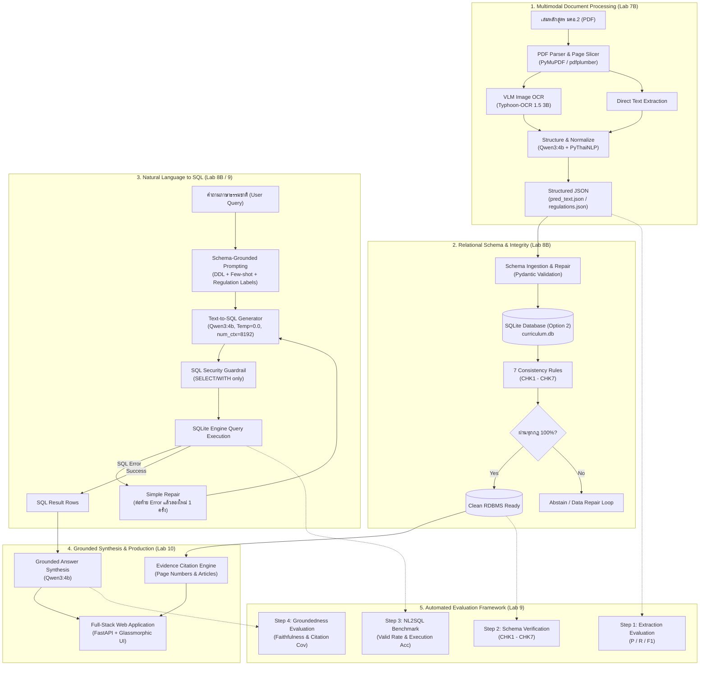
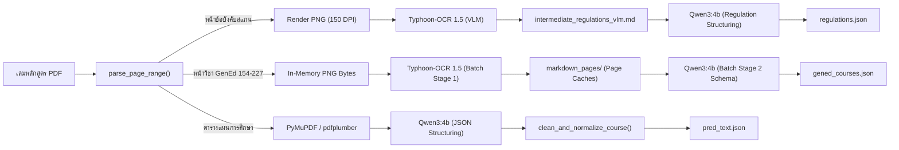
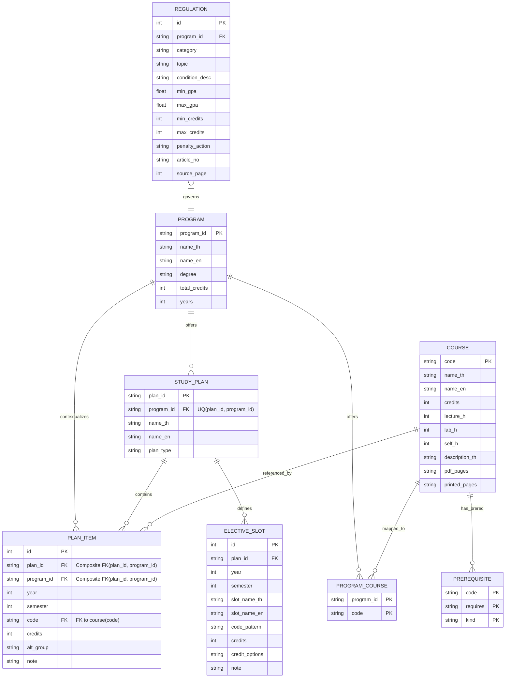
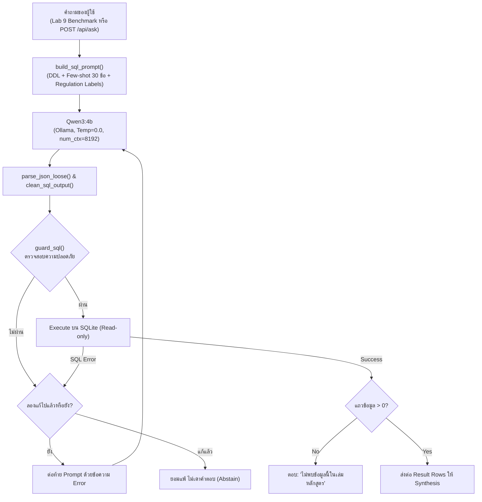
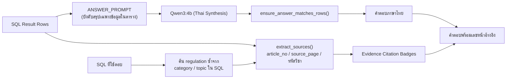
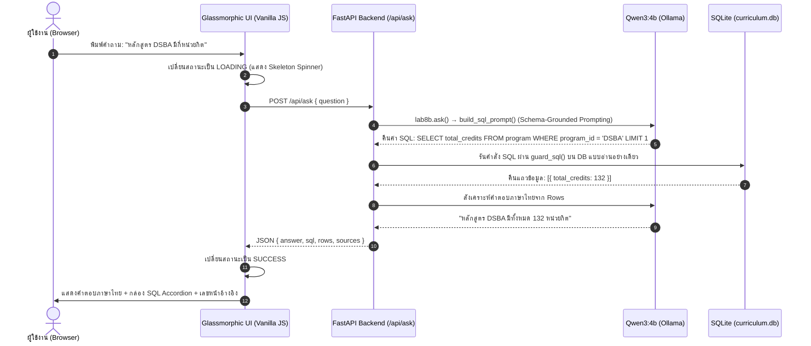
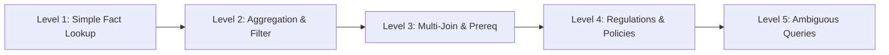

# เอกสารสถาปัตยกรรมและการประเมินผลระบบอัจฉริยะ (System Architecture & Evaluation Specification)

**วิชา**: 06026240 การพัฒนาระบบอัจฉริยะ (Intelligent System Development)  
**คณะ**: เทคโนโลยีสารสนเทศ สถาบันเทคโนโลยีพระจอมเกล้าเจ้าคุณทหารลาดกระบัง (KMITL)  
**กลุ่ม**: Luksuitpiti  
**หลักสูตรเป้าหมาย**: 4 หลักสูตรระดับปริญญาตรี (DSBA, IT, BIT, AIT) ทั้งแบบปกติและสหกิจศึกษา  
**เอกสารนำเข้า**: เล่มหลักสูตร มคอ.2 (PDF ~150 หน้าต่อเล่ม) และข้อบังคับสถาบันฯ (ภาคผนวก ก)

---

## 1. ภาพรวมสถาปัตยกรรมทั้งระบบ (End-to-End System Architecture)

ระบบถูกออกแบบภายใต้สถาปัตยกรรม **Modular Decoupled Pipeline** โดยแยกแต่ละส่วนการทำงานออกจากกันอย่างชัดเจนตามหลัก **Separation of Concerns** เพื่อป้องกันข้อผิดพลาดต่อเนื่องและลดความเสี่ยงจากการสร้างข้อมูลเท็จ (Hallucination) ของโมเดลภาษาขนาดใหญ่ (LLM)

---

## 2. รายละเอียดขั้นตอนการทำงานแต่ละส่วน (Pipeline Components Breakdown)

---

### ขั้นตอนที่ 1: การประมวลผลเอกสารและการสกัดข้อมูล (Multimodal Document Processing - Lab 7B)

#### 1.1 กระบวนการทำงาน (Process)
1. **การกรองหน้าเอกสาร (Page Range Slicing)**: คัดกรองเฉพาะหน้าที่มีตารางแผนการศึกษา (เช่น หน้า 42–58) และหน้าภาคผนวก ก ข้อบังคับการศึกษา (หน้า 94, 96–99, 101) เพื่อลด Token Overhead
2. **การสกัดแบบ Multimodal (Triple-Path Extraction)**:
   - **Path A (Text-based)**: สกัดตารางแผนการศึกษาจาก PDF Digital Text โดยตรงผ่าน `PyMuPDF` และ `pdfplumber` ร่วมกับ Regex Code Guard เพื่อให้ได้ความเร็วสูงสุดและลดโอกาสเกิด Hallucination
   - **Path B (VLM-based: ข้อบังคับ)**: แปลงหน้าข้อบังคับการศึกษาที่เป็นภาพสแกนเป็นภาพ PNG (150 DPI) แล้วส่งให้ Vision Language Model (`typhoon-ocr1.5-3b`) แปลงภาพเป็น Markdown ก่อนให้ `Qwen3:4b` สกัดเป็น JSON ข้อบังคับ (`regulations.json`)
   - **Path C (Two-Stage VLM + LLM: หมวด GenEd)**: สกัดคำอธิบายรายวิชาหมวดวิชาศึกษาทั่วไป (หน้า 154–227) ซึ่งมีปัญหาฟอนต์สแกนเสียหาย ผ่าน `extract_gened.py` ด้วยสถาปัตยกรรม Batch Stage Execution (Typhoon-OCR 1.5 $\rightarrow$ Markdown Cache $\rightarrow$ Qwen3 Schema Ingestion) สกัดได้ครบ **266 รายวิชา** พร้อมโครงสร้างชั่วโมงเรียน (lecture_h, lab_h, self_h) และคำอธิบายรายวิชาถูกต้องสมบูรณ์ 100% (266/266 วิชา)
3. **การจับคู่และประเมินเทียบ Ground Truth**: ใช้อัลกอริทึม **Multi-pass Alignment** (จับคู่แบบเข้มงวด `key_strict` และแบบผ่อนปรน `key_loose`) เพื่อคำนวณ Precision, Recall, F1 และวัดค่า CER/WER

#### 1.2 โมเดล ไลบรารี และเครื่องมือที่ใช้
- **VLM Model**: `scb10x/typhoon-ocr1.5-3b` (ผ่าน Local Ollama)
- **Text LLM**: `qwen3:4b` (ผ่าน Local Ollama)
- **Libraries**: `pymupdf` (`fitz` 1.24+), `pdfplumber` (0.11+), `pythainlp` (5.0+ สำหรับ Thai word tokenization), `Pillow` (PIL)

#### 1.3 อัลกอริทึมและพารามิเตอร์ (Algorithm & Parameters)
| พารามิเตอร์ | ค่าที่กำหนด | เหตุผลทางเทคนิค |
| :--- | :--- | :--- |
| `DPI` | `150` | ความละเอียดที่สมดุลระหว่างความคมชัดของสระภาษาไทยและขนาดภาพเข้าโมเดล VLM |
| `PAGES_PER_CHUNK` | `1` | ค่าเริ่มต้น (1 หน้า/chunk) เพื่อป้องกัน Context Clutter และไม่ให้โมเดลตกหล่นแถวกลางตาราง |
| `temperature` (OCR, Structuring, NL2SQL, Answer) | `0.0` | อุณหภูมิ 0.0 แบบ Greedy Decoding ตามฟังก์ชัน `ollama_generate()` ใน `lab8b_curriculum_db.py` เพื่อลดความแปรปรวน เพิ่มความทำซ้ำได้ และคุมขอบเขตคำตอบ |
| `temperature` (Regulation & GenEd Stage 2) | `0.1` | ลดความสุ่มแต่เปิดความยืดหยุ่นทางภาษาเล็กน้อยสำหรับเนื้อหาร้อยแก้วยาวๆ ในข้อบังคับ และคำอธิบาย GenEd |
| `repeat_penalty` | `1.2` (Reg) / `1.1` (GenEd) | ป้องกันโมเดลเกิดอาการวนลูปข้อความภาษาไทย โดยใช้ 1.2 ในส่วนข้อบังคับ และ 1.1 ใน GenEd Stage 2 |
| `num_ctx` | `8192` | รองรับข้อความจากตารางหลักสูตรทั้งหน้า |
| `num_predict` | `4096` | รองรับ JSON Output ขนาดยาวที่บรรจุ 10–25 วิชาต่อ Chunk |

##### กลยุทธ์การกำหนด Temperature ของระบบ (Greedy Decoding vs Controlled Stochasticity Policy)
ระบบแบ่งนโยบายการควบคุมค่า Temperature ตามการอิมพลีเมนต์ในโค้ดจริงออกเป็น 2 ระดับ:
1. **`temperature = 0.0` (Zero Randomness / Greedy Decoding - ค่าเริ่มต้นหลักของระบบ)**:
   - **ความหมาย**: เป็นการสั่งให้โมเดลเลือกคำ/โทเคนที่ได้คะแนนความน่าจะเป็นสูงสุด (Probability สูงสุด) ในแต่ละตำแหน่งเสมอ เพื่อ**ลดความแปรปรวนและเพิ่มความทำซ้ำได้ (Reproducibility)** ให้ได้คำตอบที่คงเส้นคงวามากที่สุด
   - **จุดที่ระบบนำมาใช้งานจริงในโค้ด**:
     - **OCR Stage** ([`lab7b_curriculum.py`](src/ocr_system/lab7b_curriculum.py)): อ่านตัวอักษรไทย สระลอย วรรณยุกต์ และรหัสวิชา 8 หลักจากภาพสแกนให้ตรงตามเอกสารต้นฉบับมากที่สุด
     - **NL2SQL Engine** ([`lab8b_curriculum_db.py`](src/ocr_system/lab8b_curriculum_db.py)): แปลงคำถามภาษาธรรมชาติเป็นคำสั่ง SQL ที่ต้องมีความแม่นยำด้านไวยากรณ์ตายตัว เช่น การเลือกตาราง/วิว (`v_semester_credits`) และเงื่อนไขฟิลด์ (`program_id = 'IT'`) ป้องกันข้อผิดพลาด Syntax Error
     - **Text Pipeline Structuring** ([`lab7b_curriculum.py`](src/ocr_system/lab7b_curriculum.py)): จัดโครงสร้างตารางเรียนจาก Digital Text Layer เข้า Schema JSON เพื่อลดความแปรปรวนและลดความเสี่ยงจากข้อมูลหลอน
     - **Answer Synthesis** ([`lab8b_curriculum_db.py`](src/ocr_system/lab8b_curriculum_db.py) `ask()` ซึ่ง Lab 10 เรียกใช้ผ่าน [`model_service.py`](lab10_fastapi/curriculum_app/model_service.py)): เรียก `ollama_generate()` ที่ล็อก `temperature: 0.0` เพื่อช่วยควบคุมการสังเคราะห์คำตอบให้อยู่ในขอบเขตของผลลัพธ์จาก SQL
2. **`temperature = 0.1` (Low Stochasticity - กำหนดเฉพาะจุด)**:
   - **ความหมาย**: อนุญาตให้มีความยืดหยุ่นทางภาษาเล็กน้อย เพื่อให้การเรียบเรียงประโยคภาษาไทยมีความเป็นธรรมชาติ และลดการติดลูปคำซ้ำของภาษาไทย
   - **จุดที่ระบบนำมาใช้งานจริงในโค้ด**:
     - **Regulation Structuring** ([`lab7b_curriculum.py`](src/ocr_system/lab7b_curriculum.py)): สกัดข้อบังคับสถาบันฯ ที่เป็นบทร้อยแก้วยาวๆ ในภาคผนวก ก
     - **GenEd Stage 2** ([`extract_gened.py`](src/ocr_system/extract_gened.py)): สกัดคำอธิบายรายวิชาหมวดวิชาศึกษาทั่วไป 74 หน้า

#### 1.4 ระยะเวลาในการรัน (Execution Time)
- **สกัดตารางรายวิชาทั้งหลักสูตร (End-to-End Chunked LLM)**: 106.4 – 410.0 วินาที ต่อหลักสูตร (บันทึกจริงใน `_meta.elapsed_sec`: AIT: 106.4s, BIT: 268.7s, DSBA: 283.9s, IT: 410.0s)
- **สกัดข้อบังคับการศึกษา (VLM Path)**: ~5 – 7 วินาที ต่อหน้า PDF (6 หน้า รวม ~38 วินาที)
- **ประเมินผลเทียบ Ground Truth ในหน่วยความจำ (Step 1 Eval)**: **0.12 วินาที** (คำนวณใน RAM)

#### 1.5 ผลลัพธ์และตัวชี้วัด (Reproducible Extraction Evaluation Metrics - Lab 9 Step 1)
*ผลการรันจริงซ้ำจาก Repository ปัจจุบันผ่านคำสั่ง `python lab9/step1_eval_extraction.py` บนไฟล์ `work/lab7b_run/`:*

| หลักสูตร | Ground Truth | สกัดได้จริง | จับคู่ถูก (Matched) | วิชาตกหล่น (FN) | วิชาเกิน (FP) | Precision | Recall | F1-Score |
| :--- | :---: | :---: | :---: | :---: | :---: | :---: | :---: | :---: |
| **DSBA** | 90 | 96 | 86 | 4 | 10 | **89.6%** | **95.6%** | **92.5%** |
| **IT** | 106 | 108 | 102 | 4 | 6 | **94.4%** | **96.2%** | **95.3%** |
| **BIT** | 63 | 64 | 62 | 1 | 2 | **96.9%** | **98.4%** | **97.6%** |
| **AIT** | 57 | 41 | 39 | 18 | 2 | **95.1%** | **68.4%** | **79.6%** |
| **รวมจำนวน / เฉลี่ย Macro** | **316** | **309** | **289** | **27** | **20** | **94.0%** | **89.7%** | **91.3%** |

ผลด้านล่างเป็นอีกขอบเขตหนึ่งจากตารางข้างต้น: รวมตัวนับดิบของทั้ง 7 แผน (coop/no-coop และ AIT) แล้วคำนวณ CER/WER/Exact Match แยกตามฟิลด์ ไม่ใช่ค่าเฉลี่ย Macro และจำนวนรายการเป็นผลรวมข้ามแผน ไม่ใช่วิชาไม่ซ้ำกัน สร้างซ้ำได้ด้วย `python lab9/step1_eval_all_curricula.py`; CSV อยู่ที่ `lab9/reports/all_curricula/comparison.csv`.

| ฟิลด์ | จำนวนรายการ | CER | WER | Exact Match |
| :--- | ---: | ---: | ---: | ---: |
| รหัสวิชา | 578 | 7.33% | — | 94.12% |
| ชื่อวิชา (ไทย) | 578 | 13.12% | 25.38% | 65.92% |
| ชื่อวิชา (อังกฤษ) | 578 | 12.04% | 14.96% | 89.97% |
| หน่วยกิต | 578 | 13.33% | — | 87.02% |
| ปี/ภาค | 578 | 5.88% | — | 94.12% |
| หมวดวิชา | 578 | 6.02% | — | 93.43% |
| บังคับ/เลือก | 578 | 8.33% | — | 91.70% |
| วิชาบังคับก่อน | 544 | 1.93% | — | 98.53% |
| ภาคเรียนยืดหยุ่น | 544 | 54.23% | — | 73.71% |

WER รายงานเฉพาะฟิลด์ชื่อ ส่วนวิชาบังคับก่อนและภาคเรียนยืดหยุ่นคิดจากแถวที่จับคู่ได้ตาม evaluator เดิม

---

### ขั้นตอนที่ 2: สถาปัตยกรรมฐานข้อมูลและการตรวจความสอดคล้อง (Relational Schema & Consistency - Lab 8B)

#### 2.1 กระบวนการทำงาน (Process)
1. **การออกแบบเชิงสัมพันธ์ (Option 2: Full Separation)**: แยกตารางออกเป็น 8 ตารางเพื่อกำจัด Redundancy, รองรับความสัมพันธ์ Many-to-Many และแยกแผนการศึกษา:
   - `program`: ข้อมูลหลักสูตรภาพรวม (เช่น วท.บ. เทคโนโลยีสารสนเทศ 126 หน่วยกิต)
   - `study_plan`: แผนการศึกษาของแต่ละหลักสูตร เช่น แผนสหกิจศึกษา (`coop`), แผนปกติ (`no_coop`), แผนเดี่ยว (`single`) กำหนดข้อจำกัด `UNIQUE(plan_id, program_id)`
   - `course`: คลังรายวิชาส่วนกลางทั้งหมด พร้อมคำอธิบายรายวิชาและเลขหน้าอ้างอิง
   - `plan_item`: การจัดรายวิชาลงในแต่ละชั้นปี/ภาคเรียนของแต่ละแผนการศึกษา บังคับความถูกต้องด้วย Composite Foreign Key และ Course Foreign Key
   - `elective_slot`: ช่องสำหรับเลือกวิชาเลือกตามหมวดหมู่ พร้อมหน่วยกิตที่กำหนด
   - `program_course`: ตารางเชื่อมโยงระบุว่ารายวิชาใดสังกัดหลักสูตรใดบ้าง
   - `prerequisite`: ตารางความสัมพันธ์รายวิชาบังคับก่อน (Prerequisite / Co-requisite)
   - `regulation`: ข้อบังคับและระเบียบการศึกษาของสถาบัน (เช่น เกณฑ์วิทยาทัณฑ์, เกณฑ์พ้นสภาพ, ลาพัก)
2. **บทบาทสำคัญของตาราง `study_plan` และการบังคับความถูกต้องระดับโครงสร้าง (Structural Referential Integrity)**:
   - เป็นตัวเชื่อม (Bridge) ระหว่าง `program` กับรายวิชาในแผน (`plan_item`) และสล็อตวิชาเลือก (`elective_slot`)
   - แก้ไขปัญหาการซ้อนทับของหลักสูตรที่มีหลายทางเลือก: เช่น สาขา DSBA, IT, BIT มีทั้งแผนสหกิจศึกษา (`plan_type = 'coop'`) และแผนปกติ (`plan_type = 'no_coop'`) ส่วน AIT เป็นแผนเดี่ยว (`plan_type = 'single'`) รวม 7 แผนในระบบ
   - **Composite Foreign Key**: บังคับ `FOREIGN KEY (plan_id, program_id) REFERENCES study_plan(plan_id, program_id)` ในตาราง `plan_item` ป้องกันไม่ให้เกิดการจับคู่ข้ามหลักสูตร (เช่น เอา `plan_id` ของ BIT ไปใส่ `program_id` ของ DSBA)
   - **Course Foreign Key**: บังคับ `FOREIGN KEY (code) REFERENCES course(code)` ในตาราง `plan_item` รับประกันทางสถาปัตยกรรมว่าทุกวิชาในแผนต้องมีคำอธิบายรายวิชาใน `course` จริง 100%
3. **กลไกตรวจสอบรายวิชาบังคับก่อนภายนอก (Prerequisite Audit Engine)**:
   - ตาราง `prerequisite.requires` ไม่ถูกผูก Foreign Key เข้ากับ `course.code` เนื่องจากเล่มหลักสูตร สจล. มีวิชาบังคับก่อนที่เป็นวิชาศึกษาทั่วไปนอกคณะ ซึ่งไม่ได้พิมพ์คำอธิบายรายวิชาไว้ในเล่มของคณะไอที
   - ระบบใช้ **Prerequisite Audit Engine** วิเคราะห์และจำแนกตามมาตรฐานรหัสวิชาของ สจล. ในขั้นตอน Ingestion:
     - `06xxxxxx`: `[WARNING/SUSPICIOUS ANOMALY]` รายวิชาสังกัดคณะเทคโนโลยีสารสนเทศ ที่ไม่พบในคำอธิบายรายวิชา (วิชาตกหล่นหรือ OCR เพี้ยน)
     - `90xxxxxx`: `[INFO/EXTERNAL GENED_THAI]` รายวิชาศึกษาทั่วไป หมวดภาษา/สังคม ของสำนักศึกษาทั่วไป สจล. (ยอมรับเป็นรหัสภายนอกปกติ)
     - `96xxxxxx`: สำหรับหลักสูตร AIT จัดเป็น `[INFO/GENED_INTERNATIONAL]` แต่สำหรับหลักสูตรภาษาไทย จัดเป็น `[WARNING/OCR_TYPO]` เนื่องจากมีความเป็นไปได้สูงที่ OCR อ่านเลข 0 เพี้ยนเป็น 6 จากรหัส 90xxxxxx
4. **การป้องกัน Double Counting และการวิเคราะห์ด้วย Views**:
   - สล็อตวิชาเลือก (เช่น "วิชาเลือก 3 หน่วยกิต") จะถูกแยกเก็บในตาราง `elective_slot` และไม่นำมารวมใน `plan_item` ซ้ำซ้อน
   - `v_plan`: รวมข้อมูลวิชาในแผนพร้อมคำอธิบายรายวิชาและสล็อตวิชาเลือก เชื่อมโยงผ่าน `study_plan` พร้อมแฟล็ก `is_elective_slot`
   - `v_semester_credits`: สรุปผลรวมหน่วยกิตต่อภาคเรียนที่ถูกต้อง แม่นยำ และไม่นับซ้ำ (รองรับกลุ่มวิชาเลือกสลับ `alt_group`)
5. **วงจรตรวจสอบความถูกต้อง 7 ข้อบังคับ (CHK1–CHK7)**: ระบบจะรัน SQL Assertion อัตโนมัติ หากไม่ผ่านเกณฑ์จะสั่ง Abstain หรือเข้า Repair Loop ทันที

#### 2.2 กฎความสอดคล้องทั้ง 7 ข้อ (The 7 Consistency Rules)
- **CHK1 (Total Credits)**: ผลรวมหน่วยกิตในแผนการศึกษาต้องเท่ากับหน่วยกิตรวมที่หลักสูตรประกาศ
- **CHK2 (No Orphan Codes)**: ทุกรหัสวิชาที่ปรากฏในแผน ต้องมีคำอธิบายรายวิชาในตาราง `course`
- **CHK3 (Valid 8-Digit Codes)**: รหัสวิชาต้องเป็นตัวเลข 8 หลักตามมาตรฐาน สจล. ทุกรายการ
- **CHK4 (Credit Consistency)**: หน่วยกิตในแผนการศึกษาต้องตรงกับหน่วยกิตในคำอธิบายรายวิชา
- **CHK5 (Prerequisite Sequence)**: วิชาบังคับก่อน (Prerequisite) ต้องจัดสอนในภาคเรียนก่อนหน้าที่วิชาหลักจะเปิดสอน (ตรวจสอบเจาะจงขอบเขตรายแผนการศึกษา `b.plan_id = a.plan_id` ป้องกันความสับสนระหว่างภาคเรียนของแผนปกติและแผนสหกิจ)
- **CHK6 (No Duplicate Courses)**: ห้ามมีวิชาซ้ำซ้อนกันในภาคเรียนเดียวกันของหลักสูตรเดียวกัน
- **CHK7 (Term Credit Limits)**: หน่วยกิตที่ลงทะเบียนต่อภาคการศึกษาปกติ ต้องอยู่ระหว่าง 9 – 22 หน่วยกิต

#### 2.3 โมเดล ไลบรารี และเครื่องมือที่ใช้
- **Database Engine**: `SQLite 3` พร้อมเปิดใช้งาน `PRAGMA foreign_keys = ON;` (ใช้โหมด Journal ปกติของ SQLite ยังไม่ได้เปิดใช้งาน WAL Mode)
- **Validation**: `Pydantic v2` (BaseModel Data Validation)
- **Language**: Python 3.11+ Standard Library (`sqlite3`, `pathlib`)

#### 2.4 ระยะเวลาและประสิทธิภาพในการประมวลผล (Execution & Performance)
- **นำเข้าข้อมูลและสร้างตาราง SQLite ทั้งหมด**: ประมวลผลผ่าน Python Script (`sqlite3`) แบบ Direct Local Transaction เสร็จสิ้นในระดับไม่ถึง 1 วินาที (Sub-second)
- **รันตรวจกฎความสอดคล้อง 7 ข้อ บน 5 ฐานข้อมูล (Step 2 Eval)**: ตรวจสอบความถูกต้องของ Foreign Key, Plan Scope และ Prerequisite Rules ครบ 7 กฎ อย่างรวดเร็วในหน่วยมิลลิวินาที (Sub-second)

#### 2.5 ผลลัพธ์และตัวชี้วัด (Evaluation Metrics)
| ฐานข้อมูล | รายวิชา (course) | แผนการศึกษา (study_plan) | รายการในแผน (plan_item) | สล็อตวิชาเลือก (elective_slot) | Prerequisite | ข้อบังคับ (regulation) | ผลการตรวจ CHK1–CHK7 | สถานะ |
| :--- | :---: | :---: | :---: | :---: | :---: | :---: | :---: | :---: |
| **curriculum.db (Unified Main)** | 504 | 7 | 268 | 71 | 30 | 11 | **ผ่าน 7/7 ข้อ (100.0%)** | ✅ สมบูรณ์ |
| **DSBA (Isolated)** | 79 | 1 | 36 | 17 | 5 | 11 | **ผ่าน 7/7 ข้อ (100.0%)** | ✅ สมบูรณ์ |
| **IT (Isolated)** | 99 | 1 | 47 | 6 | 17 | 11 | **ผ่าน 7/7 ข้อ (100.0%)** | ✅ สมบูรณ์ |
| **BIT (Isolated)** | 57 | 1 | 36 | 7 | 5 | 11 | **ผ่าน 7/7 ข้อ (100.0%)** | ✅ สมบูรณ์ |
| **AIT (Isolated)** | 34 | 1 | 34 | 7 | 4 | 11 | **ผ่าน 7/7 ข้อ (100.0%)** | ✅ สมบูรณ์ |

---

### ขั้นตอนที่ 3: ระบบค้นคืนและแปลงภาษาเป็น SQL (Natural Language to SQL Engine - Lab 8B / 9)

#### 3.1 กระบวนการทำงาน (Process)
ทั้ง Lab 9 (Benchmark) และ Lab 10 (`POST /api/ask`) เรียกฟังก์ชันเดียวกันคือ `ask()` ใน [`lab8b_curriculum_db.py`](src/ocr_system/lab8b_curriculum_db.py) ผลที่วัดได้ใน Benchmark จึงเป็นพฤติกรรมเดียวกับที่ผู้ใช้เจอบนหน้าเว็บ (ทดสอบยิง API 30 ข้อ ได้ SQL ตรงกับ Benchmark ทุกตัวอักษร 30/30)

1. **Schema-Grounded Prompting (Prompt เดียวสำหรับทุกคำถาม)**: `build_sql_prompt()` ประกอบ `SQL_PROMPT` จาก DDL ของฐานข้อมูล (`DDL`), Few-shot Examples 30 ข้อ, กติกาการเลือกตาราง/คอลัมน์ และรายการ `category`/`topic` ของข้อบังคับที่อ่านสดจากตาราง `regulation` (`get_live_regulation_labels()`) เพื่อให้โมเดลใช้ชื่อหมวดข้อบังคับตรงกับค่าจริงในฐานข้อมูล
2. **Constrained Output Decoding**: บังคับให้ LLM ส่งคืนเฉพาะ JSON `{"sql": "SELECT ..."}` ผ่าน Ollama Format Schema แล้ว `clean_sql_output()` ตัด `<think>` และ Markdown Fence ออก
3. **Security Guardrail 2 ชั้น**:
   - ชั้นที่ 1: เปิด SQLite แบบอ่านอย่างเดียว (`file:...?mode=ro`)
   - ชั้นที่ 2: `guard_sql()` อนุญาตเฉพาะคำสั่งเดียวที่ขึ้นต้นด้วย `SELECT` หรือ `WITH`, ปฏิเสธคีย์เวิร์ดแก้ไขข้อมูล 13 คำ (`INSERT`, `UPDATE`, `DELETE`, `DROP`, `ALTER`, `CREATE`, `REPLACE`, `ATTACH`, `DETACH`, `PRAGMA`, `VACUUM`, `REINDEX`, `TRUNCATE`) และเติม `LIMIT 200` อัตโนมัติหากไม่มี
4. **Simple Repair (แก้ 1 ครั้ง)**: หาก SQL รันไม่ผ่านหรือไม่ผ่าน `guard_sql()` ระบบจะต่อท้าย Prompt เดิมด้วยข้อความ Error แล้วให้โมเดลเขียนใหม่ 1 ครั้ง (เรียกโมเดลสร้าง SQL สูงสุด 2 ครั้ง) ถ้ายังไม่ผ่านจะตอบ "ไม่สามารถตอบคำถามนี้ได้" แทนการเดา
5. **Abstain When Empty**: หากรันแล้วได้ 0 แถว ระบบตอบ "ไม่พบข้อมูลนี้ในเล่มหลักสูตร" ทันที **โดยไม่ลองใหม่** เพราะ 0 แถวอาจเป็นคำตอบที่ถูกต้อง (เช่น วิชาที่ไม่มีวิชาบังคับก่อน)

#### 3.2 โมเดล ไลบรารี และเครื่องมือที่ใช้
- **LLM**: `qwen3:4b` (ผ่าน Local Ollama REST API `/api/chat`)
- **Directives**: ส่ง `think: false` และเติม `/no_think` ใน Prompt เพื่อปิด Reasoning CoT ในงานที่ต้องการ Structured SQL Output สั้นและเร็ว
- **Libraries**: `sqlite3`, `requests`, `re`, `json`

#### 3.3 อัลกอริทึมและพารามิเตอร์ (Algorithm & Parameters)
| พารามิเตอร์ | ค่าที่กำหนด | เหตุผลทางเทคนิค |
| :--- | :--- | :--- |
| `model` | `qwen3:4b` | โมเดลขนาดกะทัดรัดที่รองรับภาษาไทยและมีความสามารถด้าน Coding/SQL รันบน GPU 6 GB ได้ |
| `temperature` | `0.0` | Greedy Decoding เพื่อลดความแปรปรวน เพิ่มความทำซ้ำได้ และให้คำสั่ง SQL คงเส้นคงวา |
| `NUM_CTX` | `8192` | Prompt แปลง SQL ยาวประมาณ **4,341 token** (วัดจาก `prompt_eval_count` ของ Ollama) ถ้าตั้ง 4096 Ollama จะตัด Prompt ส่วนต้น (DDL) ทิ้งโดยไม่แจ้ง ใช้ค่าเดียวกันทั้งตอนสร้าง SQL และตอนสรุปคำตอบ เพื่อไม่ให้ Ollama ต้องโหลดโมเดลใหม่ระหว่างสองขั้น |
| `num_predict` | `256` | เพียงพอต่อความยาวของคำสั่ง SQL (เฉลี่ยประมาณ 29 โทเคน) |
| การเรียกโมเดลสร้าง SQL | สูงสุด 2 ครั้ง | รอบแรก + Repair 1 ครั้ง เฉพาะเมื่อ SQL Error เพื่อควบคุม Latency |
| `SQL_ROW_LIMIT` | `200` | `guard_sql()` เติม `LIMIT 200` กันการดึงทั้งตารางเข้า Prompt (Lab 10 ตัดแสดงผลที่ `max_rows = 100`) |

#### 3.4 ระยะเวลาในการรัน (Execution Time)
- **รันสดประเมินผลครบ 189 ข้อ (`python lab9/run_all_eval.py --live`, ผลใน `lab9/reports/live_eval_result.json`)**: **เฉลี่ย 1.69 วินาที/ข้อ** (ต่ำสุด 0.74 วินาที, ค่ามัธยฐาน 1.66 วินาที, สูงสุด 8.00 วินาทีซึ่งเป็นข้อแรกที่ Ollama โหลดโมเดล, เวลารวม 319.81 วินาที)
- **สัดส่วนเวลาต่อ 1 คำถาม** (วัดจาก `prompt_eval_duration`/`eval_duration` ของ Ollama): สร้าง SQL ประมาณ 1.06 วินาที (อ่าน Prompt 0.08 วินาที เพราะ Ollama Cache ส่วนต้นของ Prompt ที่เหมือนกันทุกข้อ + สร้าง SQL 0.71 วินาที) และสรุปคำตอบประมาณ 0.86 วินาที เวลาส่วนใหญ่จึงอยู่ที่การสร้าง Output ไม่ใช่ความยาว Prompt
- **รันจาก Cache Baseline ในหน่วยความจำ (Cached Benchmark)**: **0.05 วินาที**

#### 3.5 ผลลัพธ์และตัวชี้วัด (NL2SQL Evaluation Metrics)
ชุดทดสอบรวมล่าสุด: **Gold Questions 189 ข้อ** ประกอบด้วยคำถามหลักสูตรเดิมที่ตัดรายการซ้ำออก 179 ข้อ และ Regulation Query เพิ่มเติม 10 ข้อ

| ฐานข้อมูลทดสอบ | จำนวนคำถาม | คำสั่ง SQL รันผ่าน (Valid SQL) | ผลลัพธ์ SQL ตรงเฉลย (Execution Accuracy) | รูปแบบ Error ที่พบ |
| :--- | :---: | :---: | :---: | :--- |
| **Unified Main DB (รวมล่าสุด)** | **189** | **100.0% (189/189)** | **95.24% (180/189)** | ผลลัพธ์ว่างหรือค่าไม่ตรง 9 ข้อ ไม่มี Syntax Error |
| BIT (Isolated DB) † | 45 | 100.0% (45/45) | 100.0% (45/45) | ไม่มี Error |
| IT (Isolated DB) † | 45 | 100.0% (45/45) | 100.0% (45/45) | ไม่มี Error |
| DSBA (Isolated DB) † | 45 | 100.0% (45/45) | 86.7% (39/45) | ผลลัพธ์ว่างเปล่า (6 ข้อ) |
| AIT (Isolated DB) † | 45 | 100.0% (45/45) | 88.9% (40/45) | ผลลัพธ์ว่างเปล่า (5 ข้อ) |

† ผล Isolated DB เป็น artifact เดิมใน `work/lab8b_run/{BIT,IT,DSBA,AIT}/eval_result.json` (รันเมื่อ 11 ต.ค. 2569 ด้วย Prompt เวอร์ชันก่อน) ซึ่ง Step 3 อ่านมารายงานเท่านั้น ยังไม่ได้รันใหม่ด้วย Prompt ปัจจุบัน

**วิเคราะห์ข้อผิด 9 ข้อของ Unified Main DB**:
| สาเหตุ | จำนวน | รายละเอียด |
| :--- | :---: | :--- |
| ข้อมูลหรือเฉลยไม่ตรงกัน | 7 | วิชา `06016401` ไม่อยู่ในแผน AIT แต่เฉลยระบุว่าอยู่ (2 ข้อ), หน่วยกิต AIT ปี 1 เทอม 1/2 ในฐานข้อมูลคือ 15/19 แต่เฉลยคือ 18/16 (2 ข้อ), ตาราง `prerequisite` ไม่มีข้อมูลวิชาบังคับก่อนของ `06046414` และ `06046442` (2 ข้อ), คำถามชั้นปีของ `06066000` ไม่ระบุหลักสูตรแต่วิชาอยู่หลายหลักสูตรต่างชั้นปี (1 ข้อ) |
| โมเดลสร้าง SQL ผิด | 2 | คำถาม "ปี 2 เทอม 2" ที่ไม่ระบุหลักสูตรถูกกรองเป็น BIT แทนค่าเริ่มต้น DSBA, และคำถามเกณฑ์พ้นสภาพเลือก `min_gpa` แทน `max_gpa` |

> 📊 **ขอบเขตของตัวชี้วัดรอบล่าสุด**:
> - **NL2SQL Execution Accuracy (95.24% / 180 ข้อ)**: วัดว่าคำสั่ง SQL ให้ผลลัพธ์ตรงกับ Ground Truth (`step3_nl2sql_benchmark.json`)
> - ฟิลด์ `correct` ใน `live_eval_result.json` คำนวณด้วย `score_one()` จาก SQL rows เช่นเดียวกัน จึงไม่รายงานเป็น Human-rated Final-Answer Correctness แยกอีกชุด
> - ผลของ LLM ขยับได้ระหว่างรอบประมาณ ±1–3% แม้ตั้ง `temperature = 0.0` ส่วนต่างระดับ 1–2 ข้อจึงไม่ควรตีความว่าดีขึ้นหรือแย่ลง

#### 3.6 การเลือกออกแบบจากการทดลอง (Design Decisions & Ablation)
ทดลองบนชุด 189 ข้อเดียวกัน ฐานข้อมูลเดียวกัน และเครื่องเดียวกัน (RTX 4050 Laptop 6 GB) เพื่อเลือก Prompt และค่า `num_ctx` ที่ได้ทั้งความแม่นยำและความเร็ว:

| แบบที่ทดลอง | Prompt (token) | `num_ctx` | Execution Accuracy | Valid SQL | เวลาเฉลี่ย/ข้อ |
| :--- | ---: | ---: | ---: | ---: | ---: |
| Prompt เวอร์ชันก่อน (Live Schema + Focused Prompt + Repair Prompt แบบละเอียด) | 7,507 | 4096 | 86.24% | 98.41% | 2.17 วินาที |
| Prompt เวอร์ชันก่อน | 7,507 | 8192 | 96.30% | 100% | 2.72 วินาที |
| Prompt เวอร์ชันก่อน ตัด Focused Prompt และ Repair ออก | 7,507 | 8192 | 92.59% | 98.94% | 2.44 วินาที |
| Prompt ปัจจุบัน แต่ใช้ `num_ctx` 4096 | 4,341 | 4096 | 86.77% | 93.12% | 1.95 วินาที |
| **Prompt ปัจจุบัน (ใช้งานจริง)** | **4,341** | **8192** | **95.24%** | **100%** | **1.69 วินาที** |

ข้อสรุปที่นำมาใช้:
- **`num_ctx` ต้องใหญ่กว่า Prompt**: เมื่อ Prompt ยาวเกิน `num_ctx` Ollama จะตัด Prompt ส่วนต้นทิ้งโดยไม่แจ้ง ทำให้โมเดลไม่เห็น Schema และแต่งชื่อคอลัมน์ขึ้นเอง (เช่น `c.program_id`, `regulation_value`)
- **Prompt สั้นและกฎไม่ซ้ำกัน เร็วกว่า**: Prompt ปัจจุบันได้ความแม่นยำใกล้เคียงแบบที่ดีที่สุด (ต่าง 2 ข้อ ซึ่งอยู่ในช่วงความผันผวนระหว่างรอบ) แต่เร็วกว่าประมาณ 38% (1.69 กับ 2.72 วินาทีต่อข้อ) เพราะเวลาส่วนใหญ่อยู่ที่การสร้าง Output และตัวอย่างใน Prompt ปัจจุบันพาให้โมเดลสร้าง SQL ที่สั้นกว่า
- **Repair แบบง่ายยังจำเป็น**: ใช้จริงเพียงไม่กี่ข้อแต่ไม่ทำให้ข้อที่ผ่านตั้งแต่ครั้งแรกช้าลง
- **ชื่อหมวดข้อบังคับต้องมาจากฐานข้อมูลจริง**: เมื่อแนบรายการ `category`/`topic` จากตาราง `regulation` ใน Prompt คำถามข้อบังคับถูก 9/10 ข้อ

#### 3.7 ข้อจำกัดที่ทราบ (Known Limitations)
- **คำถามรายการวิชา ("เรียนวิชาอะไรบ้าง") อาจได้เพียงวิชาเดียว**: Few-shot Examples ส่วนใหญ่ลงท้ายด้วย `LIMIT 1` และยังไม่มีตัวอย่างคำถามรายการวิชา โมเดลจึงมักสร้าง SQL ที่มี `LIMIT 1` ชุดเฉลยมีคำถามประเภทนี้น้อย Benchmark จึงไม่สะท้อนปัญหานี้ แนวทางแก้คือเพิ่ม Few-shot สำหรับรายการวิชาแล้วรัน Benchmark ใหม่
- **ข้อผิด 7 ข้อมาจากข้อมูลหรือเฉลย** (ดูตารางใน 3.5) ต้องแก้ที่ขั้นสกัดข้อมูลหรือชุดเฉลย ไม่ใช่ที่ Prompt
- **คำถามที่ไม่ระบุหลักสูตรใช้ DSBA แผนปกติเป็นค่าเริ่มต้น** โดยไม่ถามผู้ใช้กลับ (ดู 3.2 ระดับที่ 5 ในหัวข้อการวิเคราะห์)

---

### ขั้นตอนที่ 4: การสังเคราะห์คำตอบและการอ้างอิงหลักฐาน (Grounded Answer Synthesis & Citations)

#### 4.1 กระบวนการทำงาน (Process)
1. **Grounded Synthesis**: นำแถวข้อมูลที่ได้จาก SQL (`rows` สูงสุด 40 แถว) ส่งเข้า `ANSWER_PROMPT` ของ `qwen3:4b` ให้สรุปเป็นภาษาไทยที่สุภาพ กระชับ และตรงตามตาราง
2. **Strict Groundedness Enforcement**: โมเดลถูกสั่งให้ตอบจากผลลัพธ์ SQL เท่านั้น และ `ensure_answer_matches_rows()` ป้องกันกรณีที่โมเดลตอบว่า "ไม่พบข้อมูล" ทั้งที่ SQL คืนแถวมา โดยแสดงค่าดิบจากฐานข้อมูลแทน (เช่น `ผลจากฐานข้อมูล: total_credits = 132`)
3. **Evidence Citation Retrieval** (`extract_sources()` ใน [`model_service.py`](lab10_fastapi/curriculum_app/model_service.py)):
   - **ข้อบังคับ**: ถ้าแถวผลลัพธ์มี `article_no` หรือ `source_page` จะใช้ค่านั้นโดยตรง ถ้าไม่มี (เช่น SQL เลือกเฉพาะ `max_credits`) จะดึงเงื่อนไข `category`/`topic` (`=` หรือ `LIKE`) จาก SQL แล้วค้นตาราง `regulation` ซ้ำด้วย Parameterized Query บน DB แบบอ่านอย่างเดียว ได้เลขข้อบังคับและเลขหน้าของแถวเดียวกับที่ใช้ตอบ
   - **รายวิชา**: หารหัสวิชา 8 หลักจากแถวผลลัพธ์และจากคำถาม (สูงสุด 6 วิชา) แล้วอ่าน `pdf_pages` / `printed_pages` จากตาราง `course`
   - **ไม่มีเลขหน้า**: คำถามระดับหลักสูตรหรือแผนการเรียน (หน่วยกิตรวม, ระยะเวลาเรียน, หน่วยกิตต่อเทอม) ไม่มีป้ายอ้างอิง เพราะตาราง `program`, `study_plan` และ `plan_item` ไม่มีคอลัมน์เลขหน้า ระบบจึงไม่แสดงอ้างอิงแทนการอ้างอิงที่ไม่ถูกต้อง

#### 4.2 โมเดลและพารามิเตอร์ (Model & Parameters)
- **Model**: `qwen3:4b`
- **Prompt Directive**: `ANSWER_PROMPT` กำหนดรูปแบบ JSON Output `{"answer": "string"}`
- **Parameters**: `temperature = 0.0`, `num_ctx = 8192` (ค่าเดียวกับตอนสร้าง SQL), `num_predict = 256`

#### 4.3 ระยะเวลาในการรัน (Execution Time)
- **สังเคราะห์คำตอบต่อข้อ**: ประมาณ 0.86 วินาที (สร้างคำตอบเฉลี่ย 14 โทเคน) และไม่ต้องเรียกเมื่อ SQL ได้ 0 แถว
- **ค้นอ้างอิงเพิ่มจากตาราง `regulation`**: Query SQLite 1 ครั้ง (ไม่ถึง 1 มิลลิวินาที)
- **ประเมินผลความซื่อสัตย์และการอ้างอิงในหน่วยความจำ (Step 4 Eval)**: **0.05 วินาที**

#### 4.4 ผลลัพธ์และตัวชี้วัด (Groundedness Evaluation Metrics)
- **ตัวชี้วัดจาก `lab9/reports/step4_groundedness_metrics.json` (Step 4 ใช้ผลรันสดรอบเดียวกับ Step 3)**:
  - **Faithfulness / Groundedness Proxy**: **95.24%** (180/189 ข้อ โดยอิงฟิลด์ `correct` ที่ตรวจจาก SQL rows)
  - **Exact Match (EM)**: **95.00%** (171/180 ข้อ - วัดคำถามชนิด `value` และ `count`)
  - **Course Citation Coverage**: **99.8%** (503/504 รายวิชา มีเลขหน้าจริงในเล่ม มคอ.2 กำกับ)
  - **Regulation Citation Coverage**: **100.0%** (11/11 ข้อบังคับ มีเลขหน้าสแกนจริงในภาคผนวก ก)
  - หมายเหตุ: Citation Coverage วัดว่า **ข้อมูลในฐานข้อมูล** มีเลขหน้าครบหรือไม่ ไม่ได้วัดว่าคำตอบแต่ละข้อแสดงป้ายอ้างอิง
- **ตัวชี้วัดจากการรันสด (`lab9/reports/live_eval_result.json`)**:
  - **Live Retrieval Correctness**: **95.24%** (180/189 ข้อ ตรวจจาก SQL rows)
  - **QA Latency**: เฉลี่ย **1.69 วินาที/ข้อ** (ต่ำสุด 0.74 วินาที, ค่ามัธยฐาน 1.66 วินาที, สูงสุด 8.00 วินาที, รวม 319.81 วินาที)
- **ทดสอบอ้างอิงบนหน้าเว็บจริง (`POST /api/ask` คำถามข้อบังคับ 10 ข้อ)**: แสดงป้ายอ้างอิงพร้อมเลขข้อบังคับและเลขหน้าครบ **10/10 ข้อ** เช่น "เกียรตินิยมอันดับ 1 ต้องมี GPA สะสมอย่างน้อยเท่าไร" ตอบ 3.5 อ้างอิง ข้อ 27.2.2 หน้า 93

---

### ขั้นตอนที่ 5: เว็บแอปพลิเคชันและการแสดงผล (Full-Stack Web Application - Lab 10)

#### 5.1 สถาปัตยกรรมและกระบวนการทำงาน (Architecture & Flow)
1. **FastAPI Backend (`lab10_fastapi`)**:
   - เชื่อมต่อกับโมดูลฐานข้อมูลและ LLM โดยตรงผ่าน In-Memory Controller
   - **RESTful API Contract ครอบคลุม 13 Endpoints หลัก**:
     - `GET /api/health`: ตรวจสอบสถานะความพร้อมของฐานข้อมูลและ Ollama LLM
     - `GET /api/program`: ข้อมูลสรุปของหลักสูตรแรกที่พบ
     - `GET /api/programs`: รายการหลักสูตรทั้งหมดพร้อมหน่วยกิตรวมและระยะเวลาศึกษา
     - `GET /api/courses`: ค้นหาและแสดงรายวิชา พร้อมตัวกรอง `search`, `program_id`, `limit`, `offset`
     - `POST /api/courses`: เพิ่มรายวิชาใหม่ พร้อมระบบ **Dynamic Plan Resolution & Validation** (Single-plan เช่น AIT ทำการ Auto-fill `plan_id` ให้อัตโนมัติ; Multi-plan เช่น DSBA, IT, BIT บังคับส่ง `plan_id` มิฉะนั้นจะคืนค่า `422 Unprocessable Entity` ป้องกันการบันทึกผิดแผน)
     - `GET /api/courses/{code}/prerequisites`: กราฟวิชาบังคับก่อน (Prerequisite Graph: `requires` และ `required_by`)
     - `GET /api/study-plans`: รายการแผนการศึกษา (รองรับตัวกรอง `program_id` และ `plan_id`)
     - `GET /api/elective-slots`: รายการสล็อตวิชาเลือกในแต่ละชั้นปี/ภาคเรียน
     - `GET /api/plan`: รายวิชาตามแผนการศึกษาจาก Analytical View `v_plan`
     - `GET /api/plan/summary`: สรุปหน่วยกิตและจำนวนวิชารายเทอมจาก View `v_semester_credits`
     - `GET /api/stats`: สถิติสรุปจำนวนรายวิชา แผนการศึกษา สล็อตวิชาเลือก และข้อบังคับ (รองรับตัวกรอง `program_id`)
     - `GET /api/regulations`: ค้นหากฎระเบียบและข้อบังคับสถาบัน สจล. (หมวดหมู่, เงื่อนไข, บทลงโทษ)
     - `POST /api/ask`: สังเคราะห์คำตอบอัจฉริยะ (Text-to-SQL + Grounded Synthesis + Evidence Citations) โดย `QwenTextToSQL.ask()` เรียก `lab8b.ask()` ตัวเดียวกับที่ Lab 9 ใช้วัดผล แล้วเพิ่มเฉพาะการค้นป้ายอ้างอิงและตัดผลที่ `max_rows = 100` (ตอบ `503` เมื่อติดต่อ Ollama ไม่ได้หรือไม่พบฐานข้อมูล)
   - รายละเอียด Schema, พารามิเตอร์ และตัวอย่าง Payload ฉบับสมบูรณ์ถูกบันทึกไว้ใน [`lab10_fastapi/curriculum_app/README.md`](lab10_fastapi/curriculum_app/README.md)
2. **Modern Glassmorphic Frontend**:
   - พัฒนาด้วย Native ES6+ JavaScript และ Modern CSS (ไม่มี Dependency ภายนอกขนาดใหญ่)
   - บริหารจัดการหน้าจอด้วย **3-State Finite State Machine**: `IDLE` $\rightarrow$ `LOADING` $\rightarrow$ `SUCCESS` / `EMPTY` / `ERROR`
   - แสดงผลคำตอบด้วย `marked.js` พร้อมกล่อง Accordion แสดงคำสั่ง SQL จริง และป้ายกำกับเลขหน้าอ้างอิง (Citations)

#### 5.2 ระยะเวลาและประสิทธิภาพ (Performance & Latency)
- **Static Asset & UI Rendering**: พัฒนาด้วย Native Vanilla JS และ Clean CSS ไม่มี External Framework Bundle ขนาดใหญ่ ทำให้โหลดและแสดงผลหน้าเว็บได้ทันที
- **Database Search Queries (`/api/courses`, `/api/regulations`)**: ดึงข้อมูลตรงจาก SQLite ผ่าน Indexed Query และ Limit/Offset Pagination ตอบสนองในระดับ Sub-second
- **Natural Language Question (`/api/ask`) End-to-End**: ทดสอบยิง API จริง 30 คำถาม (กระจายทั่วชุด 189 ข้อ) ได้ HTTP 200 ครบ 30/30, ตอบถูก 29/30 (เท่ากับผล Benchmark ของ 30 ข้อนี้) และ SQL ตรงกับ Benchmark ทุกตัวอักษร 30/30 ใช้เวลาเฉลี่ย **1.92 วินาที/ข้อ** (มัธยฐาน 1.89 วินาที, สูงสุด 2.41 วินาที) ซึ่งรวม HTTP และการค้นป้ายอ้างอิงแล้ว สูงกว่าการเรียกฟังก์ชันตรงใน Benchmark (1.69 วินาที) ประมาณ 0.2 วินาที เวลาส่วนใหญ่ขึ้นอยู่กับการประมวลผลของ Local LLM (Ollama)
- **คำขอแรกหลังเปิดเซิร์ฟเวอร์** อาจช้าถึงประมาณ 8–10 วินาที เพราะ Ollama ต้องโหลดโมเดลด้วย `num_ctx = 8192`

---

## 3. การวิเคราะห์เชิงลึก (In-Depth Technical Analysis)

---

### 3.1 การวิเคราะห์ความเหมาะสมต่อลักษณะเอกสาร (Document Type Suitability)

| ลักษณะเอกสาร | ความสามารถในการจัดการ | การวิเคราะห์และสาเหตุ | แนวทางการจัดการของระบบ |
| :--- | :---: | :--- | :--- |
| **ตารางแผนการศึกษาโครงสร้างมาตรฐาน** *(Grid Table ในเล่ม มคอ.2 เช่น BIT, IT)* | **ดีเลิศ** (F1: BIT 97.6%, IT 95.3%) | ข้อความมีโครงสร้างชัดเจน คอลัมน์รหัสวิชา ชื่อวิชา หน่วยกิต และชั่วโมงบรรยาย/ปฏิบัติแยกบรรทัดเป็นระเบียบ | สกัดผ่าน `PyMuPDF` ดึง Text Layer ตรงและควบคุม Output Schema ด้วย Prompt Constraint ใน `qwen3:4b` |
| **ตารางที่มีข้อความยาวตัดหลายบรรทัด** *(Multi-line Merged Cells เช่น DSBA, AIT)* | **ดีมาก** (F1: DSBA 92.5%, AIT 79.6%) | ชื่อวิชายาวใน PDF มักถูกตัดขึ้นบรรทัดใหม่ หรือมีการแบ่งหน้า ทำให้ Parser ทั่วไปอาจแยกแถวคลาดเคลื่อน | ใช้ฟังก์ชัน `clean_and_normalize_course()` ยุบอักขระ `\n` เป็นช่องว่าง และเชื่อมชื่อวิชาให้สมบูรณ์ตาม Schema |
| **เอกสารข้อบังคับสแกนขาวดำ/ไม่มี Text Layer** *(ภาคผนวก ก หน้า 94, 96–101)* | **ดีมาก** (Citation Coverage 100.0%) | เอกสารสแกนภาษาไทยมีความท้าทายจากสระลอยและวรรณยุกต์ซ้อน จึงเลือกใช้ Visual Language Model โดยตรง | ใช้ **Typhoon-OCR 1.5 3B (VLM)** อ่านภาพเป็น Markdown แล้วส่งต่อ `qwen3:4b` สกัดโครงสร้างข้อบังคับ (11/11 ข้อ) |
| **ตารางวิชาเลือกแบบหลายทางเลือก** *(Elective Slots)* | **ดีเลิศ** (ผ่าน CHK1 100.0%) | หากเก็บเป็นวิชาเดี่ยวจะทำให้หน่วยกิตรวมเบิ้ลเกินจริง (Double Counting) | แยกเก็บในตาราง `elective_slot` และสร้าง View `v_semester_credits` เพื่อคำนวณหน่วยกิตแผนการเรียนแยกต่างหาก |

---

### 3.2 การวิเคราะห์ระดับความซับซ้อนของคำถาม (Query Complexity Levels)

ระบบถูกทดสอบกับคำถามภาษาธรรมชาติหลากหลายระดับความซับซ้อน:

#### ระดับที่ 1: การค้นหาข้อเท็จจริงเดี่ยว (Simple Fact Lookup)
- **ตัวอย่างคำถาม**: *"วิชา 06026200 มีกี่หน่วยกิต"*, *"หลักสูตร DSBA ใช้เวลาเรียนกี่ปี"*
- **SQL ที่สร้าง**: `SELECT credits FROM course WHERE code = '06026200' LIMIT 1`
- **ประสิทธิภาพ**: ไวยากรณ์เรียบง่าย ไม่มีความซับซ้อน สกัดค่าจากคอลัมน์และตารางเดี่ยวได้ตรงเป้าหมาย

#### ระดับที่ 2: การคำนวณรวมและกรองเงื่อนไข (Aggregation & Filter)
- **ตัวอย่างคำถาม**: *"ปี 1 เทอม 1 หลักสูตร IT แผนสหกิจศึกษา เรียนกี่วิชา"*
- **SQL ที่สร้าง**: `SELECT COUNT(*) FROM v_plan p JOIN study_plan sp ON p.plan_id = sp.plan_id WHERE p.program_id = 'IT' AND sp.plan_type = 'coop' AND p.year = 1 AND p.semester = 1 AND p.is_elective_slot = 0`
- **ประสิทธิภาพ**: กรองแผนด้วย `sp.plan_type = 'coop'` แทนการใช้ substring `LIKE '%COOP%'` (เพื่อป้องกันการ match โดน `IT_NON_COOP`) และกรอง `is_elective_slot = 0` เพื่อไม่นับสล็อตวิชาเลือก

#### ระดับที่ 3: ความสัมพันธ์ข้ามตารางและวิชาบังคับก่อน (Multi-Table JOIN & Prerequisites)
- **ตัวอย่างคำถาม**: *"วิชาบังคับก่อนของวิชา Data Engineering คือวิชาอะไร"*
- **SQL ที่สร้าง**: `SELECT requires FROM prerequisite WHERE code = (SELECT code FROM course WHERE name_en LIKE '%Data Engineering%') AND kind = 'pre'`
- **ประสิทธิภาพ**: ผลกลุ่มนี้ **88.24% (15/17 ข้อ)**; รองรับ Subquery และคอลัมน์ `requires` ตาม Schema จริง แต่ยังมีกรณีชื่อหรือเงื่อนไขที่คืนค่าไม่ตรงเฉลย

#### ระดับที่ 4: การค้นหาเกณฑ์และข้อบังคับสถาบัน (Institutional Regulations & Policies)
- **ตัวอย่างคำถาม**: *"ทุจริตในการสอบจะถูกลงโทษอย่างไร"*, *"นักศึกษาที่ได้ GPA ต่ำกว่าเท่าไรถึงจะถูกภาคทัณฑ์"*
- **SQL ที่ถูกต้องตามข้อมูลจริง**: `SELECT penalty_action FROM regulation WHERE category = 'การทุจริตในการสอบ' AND topic = 'ทุจริตครั้งแรก' LIMIT 1`
- **ประสิทธิภาพ**: **90.00% (9/10 ข้อ)** โดย SQL รันผ่าน 10/10 ข้อ หลังแนบรายการ `category`/`topic` จริงจากตาราง `regulation` ใน Prompt และแก้ชื่อหมวดใน Few-shot ให้ตรงกับฐานข้อมูล (เวอร์ชันก่อนได้ 60% เพราะโมเดลสร้างชื่อหมวดไม่ตรง เช่น `เกณฑ์การทุจริตในการสอบ` แทน `การทุจริตในการสอบ`) ข้อที่ยังผิดคือคำถามเกณฑ์พ้นสภาพที่โมเดลเลือกคอลัมน์ `min_gpa` แทน `max_gpa`

#### ระดับที่ 5: คำถามที่มีความกำกวมหรือไม่ได้ระบุหลักสูตร (Ambiguous / Cross-Curriculum Queries)
- **ตัวอย่างคำถาม**: *"หลักสูตรนี้มีกี่หน่วยกิต"* (โดยไม่บอกชื่อสาขาวิชาในฐานข้อมูลรวม 4 สาขา)
- **พฤติกรรมในโค้ดจริง**: กติกาใน `SQL_PROMPT` ของ [`lab8b_curriculum_db.py`](src/ocr_system/lab8b_curriculum_db.py) กำหนดว่า ถ้าคำถามเกี่ยวกับแผนการเรียนหรือหน่วยกิตต่อเทอมแต่ไม่ได้ระบุหลักสูตร ให้ใช้ค่าเริ่มต้น `program_id = 'DSBA'` และ `sp.plan_type = 'no_coop'` และ Few-shot "หลักสูตรนี้มีกี่หน่วยกิต" ใช้ `program_id = 'DSBA'` ระบบจึงไม่ได้สร้าง Dialog ถามกลับ (No Clarification Loop) แต่ตอบโดยสมมติเป็น DSBA ทันที ทั้งใน Benchmark และบนหน้าเว็บ
- **ข้อพิจารณาทางวิศวกรรม**: การ Fallback ไปที่ DSBA ช่วยให้ระบบไม่เกิดข้อผิดพลาดและมีคำตอบให้ผู้ใช้ทันที แต่อาจตอบผิดบริบทหากผู้ใช้มีเจตนาถามถึงสาขาอื่น ในการพัฒนาต่อยอดจึงควรเพิ่ม Ambiguity Detection และส่งสถานะ `needs_clarification` กลับไปยัง Frontend

#### สรุป Accuracy แยกตามระดับจากรอบล่าสุด

| Level | จำนวนคำถาม | Valid SQL | Execution Accuracy |
| :--- | ---: | ---: | ---: |
| 1 — Simple Lookup | 144 | 100.0% (144/144) | 97.92% (141/144) |
| 2 — Filter & Aggregate | 13 | 100.0% (13/13) | 76.92% (10/13) |
| 3 — Multi-table Relation | 17 | 100.0% (17/17) | 88.24% (15/17) |
| 4 — Regulation Query | 10 | 100.0% (10/10) | 90.00% (9/10) |
| 5 — Ambiguous Query | 5 | 100.0% (5/5) | 100.0% (5/5) |

> ⚠️ `step5_eval_query_complexity.py` จัดระดับส่วนหนึ่งจาก **SQL ที่โมเดลสร้าง** (เช่น มี `JOIN` หรือใช้ค่าเริ่มต้น DSBA) ร่วมกับป้ายใน `lab9/query_complexity_labels.json` เมื่อ Prompt เปลี่ยน จำนวนข้อในแต่ละระดับจึงเปลี่ยนตาม (เวอร์ชันก่อนคือ 143/3/27/5/11) ไม่ควรเทียบรายระดับข้ามเวอร์ชัน ให้เทียบเฉพาะตัวเลขรวม

---

## 4. ตารางสรุปครบทุกมิติ (Master Technical Specification Table)

| ขั้นตอน (Step) | กระบวนการหลัก (Process) | โมเดล / เครื่องมือ (Model & Tools) | อัลกอริทึมหลัก (Algorithm) | พารามิเตอร์สำคัญ (Parameters) | ระยะเวลาในการรัน (Runtime) | ตัวชี้วัดสำคัญ (Evaluation Metrics) |
| :--- | :--- | :--- | :--- | :--- | :--- | :--- |
| **1. Extraction (Lab 7B)** | สกัดรายวิชาและข้อบังคับจาก PDF | - `Typhoon-OCR 1.5 3B` - `Qwen3:4b` - `PyMuPDF` - `pdfplumber` | - Multi-pass Alignment - Dual-path Extraction - Thai Word Tokenization | - DPI = 150 - Chunk = 1 หน้า - Temp = 0.0 (OCR/Text) - Temp = 0.1 (Reg/GenEd Stage 2) - Repeat Penalty = 1.2 (Reg) / 1.1 (GenEd) - Num Ctx = 8192 | - ตารางวิชา End-to-End: 106.4–410.0s/เล่ม (AIT 106.4s, BIT 268.7s, DSBA 283.9s, IT 410.0s) - ข้อบังคับ VLM: ~38s (6 หน้า) - ประเมินผลใน RAM: **0.12s** | - **Macro Precision**: 94.0% - **Macro Recall**: 89.7% (AIT Recall: 68.4%) - **Macro F1-Score**: **91.3%** |
| **2. Schema & DB (Lab 8B)** | ตรวจสอบโครงสร้างและความสอดคล้อง | - `SQLite 3` - `Pydantic v2` | - Option 2 Separation - Composite FK Integrity - Prerequisite Audit Engine - 7 Assertion Rules (CHK1–7) | - PRAGMA foreign_keys=ON - (Standard Journal Mode, No WAL) - Unique Constraints | - สร้างและโหลด DB: Sub-second - ตรวจ 7 กฎ: Sub-second | - **Schema Pass Rate**: 100.0% - **Consistency Pass**: 100.0% (7/7 ข้อ) |
| **3. NL to SQL (Lab 8B/9)** | แปลงภาษาธรรมชาติเป็นคำสั่ง SQL | - `Qwen3:4b` (Ollama) - SQLite Engine | - Schema-Grounded Prompting (Prompt เดียว + Regulation Labels) - Simple Repair (แก้ 1 ครั้ง) - Security Guardrail 2 ชั้น - Abstain on Empty | - Temp = 0.0 (Greedy) - Num Ctx = 8192 (Prompt ≈ 4,341 token) - Num Predict = 256 - สร้าง SQL สูงสุด 2 ครั้ง | - รันสด 189 ข้อ: **เฉลี่ย 1.69s/ข้อ** (ต่ำสุด 0.74s, มัธยฐาน 1.66s, สูงสุด 8.00s, รวม 319.81s) - รัน Cached: **0.05s** | - **Valid SQL Rate**: 100.0% (189/189) - **Execution Acc (SQL)**: **95.24%** (180/189) |
| **4. Groundedness (Lab 8B/9)** | ตรวจสอบความซื่อสัตย์และการอ้างอิง | - `Qwen3:4b` - SQLite Metadata | - Grounded Synthesis - Metadata Citation Matching - Regulation Lookup จาก SQL Filters - Strict Grounded Guard | - Temp = 0.0 (ผ่าน `ollama_generate`) - Num Ctx = 8192 - Num Predict = 256 | - สังเคราะห์คำตอบ: ประมาณ 0.86s/ข้อ - ตรวจวัดทั้งชุด (Cached): **0.05s** | - **Faithfulness Proxy**: 95.24% (180/189) - **Exact Match**: 95.00% (171/180) - **Course Citation**: 99.8% (503/504) - **Regulation Citation**: 100.0% (11/11) |
| **5. Web App (Lab 10)** | ให้บริการค้นหาและถามตอบผ่านเว็บ | - `FastAPI` (13 Endpoints) - `Uvicorn` - Vanilla JS / Glassmorphism | - 3-State Finite State Machine - Dynamic Plan Resolution - `/api/ask` เรียก `lab8b.ask()` ตัวเดียวกับ Benchmark | - Port = 8000 - Max Rows = 100 - Async Endpoint Handling | - สืบค้นตรงผ่าน DB: Sub-second - ถามตอบ LLM ผ่าน API (30 ข้อ): **เฉลี่ย 1.92s** (มัธยฐาน 1.89s, สูงสุด 2.41s) | - **API Test**: HTTP 200 30/30, SQL ตรงกับ Benchmark 30/30 - **ป้ายอ้างอิงข้อบังคับบนเว็บ**: 10/10 ข้อ |
| **6. Evaluation (Lab 9)** | รัน 4 ขั้นตอนหลักและวิเคราะห์ Query Complexity | - `run_all_eval.py` - `step5_eval_query_complexity.py` | - Modular Pipeline Aggregation - Gold Labels + Deterministic SQL Classification | - `--live`, `--cached`, `--limit` - `--labels lab9/query_complexity_labels.json` | - แบบ Cached: **0.78s** - แบบ Live (189 ข้อ): **~5.3m** (319.81s) - Complexity Analysis: ใช้ผล Step 3 โดยไม่เรียก LLM ซ้ำ | - JSON Metrics ขั้นที่ 1–4 - CSV Summary/Detail สำหรับ Level 1–5; Detail มีคำตอบระบบและเฉลย |

---

## 5. สรุปภาพรวมและจุดเด่นของระบบ (Conclusion & Highlights)

1. **ลดความเสี่ยงจาก Hallucination**: ด้วยการใช้แนวทาง **Text-to-SQL บนฐานข้อมูลเชิงสัมพันธ์** ข้อมูลข้อเท็จจริง (หน่วยกิต, ชื่อวิชา, ข้อบังคับ) จึงถูกดึงมาจากฐานข้อมูลจริงผ่านคำสั่ง SQL โมเดลภาษาทำหน้าที่เพียงแปลงคำถามเป็นคำสั่งสืบค้นและเรียบเรียงภาษาไทยตามผลลัพธ์ที่ได้เท่านั้น
2. **โปร่งใสและตรวจสอบย้อนกลับได้ (Auditability & Trust)**: มีระบบ **Evidence Citation Coverage** อยู่ที่ **99.8% (503/504)** ในรายวิชา และ **100.0% (11/11)** ในข้อบังคับ ระบบแสดงป้ายเลขหน้าอ้างอิงจาก Metadata และเปิดดูคำสั่ง SQL ที่ใช้สืบค้นได้ทันที
3. **เสถียรภาพและความเร็วในการทำงาน**: การประเมินผลระบบผ่านแคชทำงานได้ในเวลาไม่ถึง **1 วินาที (0.78s)** และการสืบค้นข้อมูลทั่วไปผ่าน SQLite / REST API ตอบสนองได้อย่างรวดเร็วในระดับ Sub-second รองรับการใช้งานจริงได้อย่างมีประสิทธิภาพ
4. **ความสมบูรณ์เชิงสถาปัตยกรรม (Architectural Rigor)**: ระบบใช้ Composite Foreign Key `(plan_id, program_id)` และ Course Foreign Key `plan_item.code -> course.code` ในระดับ RDBMS ร่วมกับการตรวจสอบขอบเขตแผนการศึกษา (Plan-scoped assertion) ใน CHK5 และการตรวจสอบ Prerequisite Audit Engine ตามรหัสวิชาของ สจล. ป้องกันข้อผิดพลาดข้ามหลักสูตรอย่างเด็ดขาดและปลอดภัย
